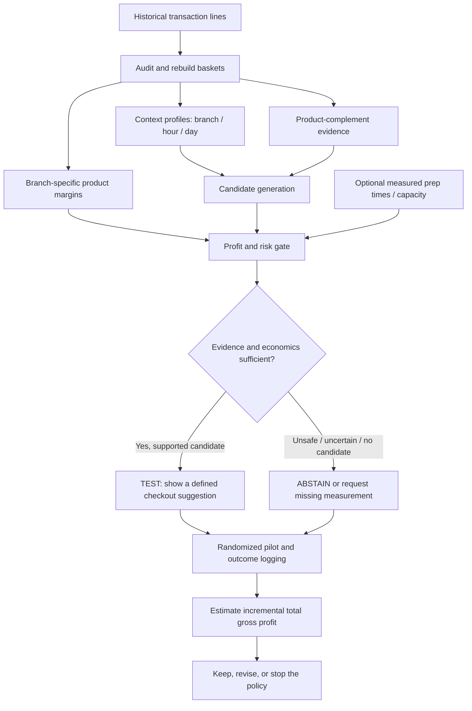

# ProfitPilot: A Context-Aware, Profit-Safe Checkout Decision Engine

**EECE490 — Stories Coffee Hackathon**  
**Status:** Research-backed project proposal, **not** a claim of proven business uplift  
**Prepared:** 17 October 2026  
**Data basis:** `stories_transactions.csv` (1 January–30 June 2026) and the supplied `EECE490 Stories Coffee Hackathon.pdf`

> **Our central question**  
> **Can Stories Coffee increase incremental gross profit by recommending the right complementary product, at the right time and branch, while avoiding unnecessary discounts and operational overload?**

---

## Executive summary

Our proposed solution, **ProfitPilot**, is not a generic coffee-sales dashboard, a “chat with your database” system, or a recommendation algorithm that blindly repeats “customers also bought.” It is a **decision-support and experimentation system** for a specific business action: **whether to suggest an additional product at checkout—and, if so, which one, under what conditions, and with what financial requirements for success**.

The opportunity emerged from a deeper investigation of 33,887 Stories transactions. **19,921** contained coffee or tea; **15,203** of those did **not** contain a bakery product. We also found repeatable product-pair associations, sharp time-of-day changes in what people buy, substantial evening traffic, and meaningful differences in gross margins across branches. Meanwhile, recorded discounts reduce unit margins and have **not** been shown to create enough incremental sales to justify their cost.

The project would combine four narrow capabilities:

1. **Context intelligence:** identify the branch, day and time regime, current basket, and expected busyness.
2. **Complement intelligence:** find statistically reliable add-on candidates, while avoiding unreliable, rare, or likely substitute pairs.
3. **Profit and risk intelligence:** calculate product margins, the additional sales needed to justify an offer, and whether operational constraints might make an offer undesirable.
4. **Decision and evidence:** produce **RECOMMEND / TEST / ABSTAIN**, with an explicit explanation and a controlled experiment to validate incremental gross profit.

**The critical scientific limitation:** Historical co-purchases do **not** reveal whether a checkout prompt makes someone buy more. ProfitPilot's first version can **rank promising experiments and calculate break-even requirements**, but it cannot truthfully claim that its suggestions maximize *causal* profit until Stories runs a randomized pilot or supplies intervention-response data.

### One-paragraph CEO pitch

> Stories' data reveals a large pool of beverage transactions that finish without a bakery purchase, stable complementary-item relationships, and clear changes in customer behavior throughout the day. Rather than automatically discount popular drinks or recommend the most frequently sold item, we propose ProfitPilot: a branch- and time-aware system that identifies financially sensible checkout experiments, suppresses weak or potentially disruptive suggestions, and shows the exact incremental conversion required for an offer to pay off. We can demonstrate historical patterns, margin calculations, and benchmarked offline prediction today; a short randomized checkout test would establish whether these recommendations create real incremental gross profit.

---

## 1. Why this is the right *type* of problem for the hackathon

The brief says Stories already has a data team and access to ChatGPT and Claude. It explicitly warns that basic sales summaries and a database chatbot are insufficient. It asks for a meaningful business problem, checked evidence, alternative explanations, cost/benefit trade-offs, simple baselines, testing on data not used in training, uncertainty, and a realistic field test. It also prohibits asking Stories questions; missing inputs must become **explicit assumptions**.

Our approach targets a decision executives actually face:

> **Should we try to grow the basket by suggesting another item, or are we about to sacrifice margin and potentially strain operations for sales that would have happened anyway?**

This reframes the objective from **more sales** to **incremental gross profit from an action**.

### Not our objective

- Predict every customer's favorite drink from a questionable customer ID.
- Produce the highest-accuracy black-box model for 45 products simply to demonstrate machine learning.
- Show attractive association-network diagrams without explaining what a manager should do.
- Claim a promotion failed merely because average sales looked unchanged.
- Claim staffing or kitchen savings without observing labor, prep time, queue lengths, or waste.
- Claim that a product pairing causes a customer to buy the second product.

### Our precise operational decision

**At the moment a beverage is in an order and no bakery item has been added yet, should the system display a specific full-price bakery suggestion, a different suggestion, or nothing?**

This is intentionally narrower than “optimize every business decision.” Forecasting and capacity enter as **supporting guardrails**, not as independent headline products.

---

## 2. Dataset and evidence we currently have

### 2.1 Source audit: verified directly from the uploaded CSV

| Fact | Result | How to interpret it |
|---|---:|---|
| Transaction line records | 51,177 | A row is a purchased product line, not necessarily a whole order. |
| Distinct transactions | 33,887 | Use transaction IDs to reconstruct baskets. |
| Date range | 2026-01-01 to 2026-06-30 | 181 calendar days; only a half-year. |
| Branches | 3 | Garden, Harbour, Uptown. |
| Distinct products | 45 | Suggested products must exist on this menu. |
| Product categories | 9 | Useful for stable category-level analysis. |
| Total recorded revenue | $305,925.14 | Accounting revenue in supplied records. |
| Total recorded gross profit | $179,430.49 | **Not** profit after labor, rent, spoilage, etc. |
| Coffee/tea-containing transactions | 19,921 | Any order with Hot Coffee, Cold Coffee, or Matcha & Tea. |
| Coffee/tea transactions *with* Bakery | 4,718 | Historical co-purchase, not prompt conversion. |
| Coffee/tea transactions *without* Bakery | **15,203** | Potential add-on audience at the completed-basket level. |
| Historical bakery attachment to coffee/tea transactions | **23.68%** | 4,718 / 19,921. |
| Harbour evening coffee/tea transactions without Bakery | **3,424** | Evening is 19:00–23:59. |
| Recorded evening gross profit across branches | **$80,044.80** | About 44.6% of six-month recorded gross profit. |
| Normal 10% discount concessions | $1,706.54 | Difference between stated undiscounted line value and recorded line revenue. |
| Special Harbour 15% discount concessions | $471.55 | Same accounting calculation for 15%-discounted lines. |

**Important eligibility nuance:** `15,203` counts **completed** orders that contained a beverage but no bakery. At an actual checkout, recommendations must be triggered **while the basket is being built**. The data does not record the sequence in which items were entered, so this figure is an **opportunity-sizing proxy**, not an exact count of impressions that a deployed system would have served.

### 2.2 Observed behavioral clues

**A. Complementary products.** Earlier exploratory permutation analyses found product pairs appearing together more frequently than expected under a stratified comparison. For example, **Iced Matcha + Pistachio Cookie appeared together in 82 transactions**. At a broader level, Matcha & Tea + Bakery had a strong positive co-purchase association. Several of these patterns were visible in both January–March and April–June analyses. Association alone does not establish response to a recommendation.

**B. The clock changes the menu.** Around **11 AM**, product mix shifts away from morning bakery emphasis. Around **6 PM**, the service mix shifts sharply toward dine-in. Around **7 PM**, hot coffee's share falls while Matcha & Tea and Desserts rise. Transaction volume peaks around **9 PM**. Thus a morning and late-evening order are not necessarily the same recommendation context.

**C. The calendar changes traffic.** Tuesday is particularly busy, with strong evening peaks at Harbour. This is relevant to the **risk of adding preparation work**, not automatic proof that staff or equipment is overloaded.

**D. Discounts consume margin.** For Harbour's special 15% promotion, the previously calculated break-even requirement for the promoted product mix was approximately **29.3% more units than the full-price counterfactual**, under fixed product costs and mix. Its true causal lift is unknown. A profit-safe approach must not confuse a discount's *observed cost* with proof that removing it would recover that cost.

**E. Product economics differ by branch.** Garden's recorded unit costs are near-exactly 1.43× Harbour's across the same 45 products. This may reflect costing conventions rather than recoverable inefficiency. ProfitPilot should use branch-specific margins, and flag suspicious cost definitions as a data-quality dependency.

**F. Customer IDs are not ready for strong personalization claims.** Identifiers are missing on about 36.5% of line records; earlier history-based prediction attempts did not improve performance over contextual rules. We should not put customer profiling at the center of the prototype.

### 2.3 Evidence taxonomy used throughout this proposal

| Label | What it means | Example |
|---|---|---|
| **OBSERVED** | Directly calculated from CSV | 15,203 completed beverage orders lacked bakery. |
| **ASSOCIATION** | Statistically related in historical records | Iced Matcha and Pistachio Cookie co-occur more than a selected null baseline predicts. |
| **BACKTESTED** | Predicted a held-out historical period | A daypart-aware co-purchase model outperformed a popularity rule in a prior exploratory split. |
| **SCENARIO** | Arithmetic under explicit assumptions | 5% incremental conversion yields a particular *hypothetical* gross-profit amount. |
| **UNKNOWN** | Cannot be measured from the given CSV | Actual prompt conversion, preparation times, stockouts, cannibalization, net profit. |
| **EXPERIMENTALLY VERIFIED** | Would require randomized intervention data | Recommendation policy caused higher gross profit per eligible order. **Not available yet.** |

---

## 3. The main proposed approach: ProfitPilot

### 3.1 Core concept

Instead of answering:

> *“Which item do people usually buy with this one?”*

ProfitPilot answers:

> *“Given this current basket, branch, time, item margin, and risk information, is there a credible add-on worth testing now—or should Stories do nothing?”*

The system is **decision-first**, not model-first.

### 3.2 System flow



### 3.3 Four components

#### Component A — Context intelligence

Inputs: `Branch`, transaction day/date, hour, current basket contents, and optionally an independently estimated workload signal.

Responsibilities:

- Identify one of three interpretable product-demand periods: **07:00–10:59**, **11:00–18:59**, **19:00–23:59**.
- Learn branch- and time-conditional category/product frequencies.
- Estimate typical order arrival intensity by branch, weekday, and hour.
- Provide a descriptive **BUSY-PERIOD WARNING** if the historical arrival distribution is high.
- Avoid claiming that historical traffic equals true utilization, queueing, or real-time capacity.

**Deliverable:** a context vector and explanation, e.g. “Harbour / Tuesday / 21:00: historically high order arrivals; caution with labor-intensive recommendations.”

#### Component B — Basket-complement intelligence

Inputs: Current basket product(s) and contextual segment.

Responsibilities:

- Construct transaction-level **sets** of purchased products and categories; avoid double-counting repeated lines as separate orders.
- Build candidate complements conditional on a known product or category.
- Compare co-purchases against reasonable baselines that account for basket size and other context.
- Require minimum support and stability across time slices; control multiple testing where relevant.
- Exclude items already in the basket unless deliberate duplicate-quantity suggestions are separately justified.
- Down-rank likely substitutes and unsupported rare combinations.
- Make no causal claims about what a prompt would sell.

**Deliverable:** a ranked shortlist of plausible *experiments*, with counts, expected counts under the selected null, direction, confidence, and weaknesses.

#### Component C — Profit and risk intelligence

Inputs: Candidate unit price, recorded unit cost, discount choice, and explicitly assumed or measured extra fulfillment burden.

Responsibilities:

- Calculate gross profit per incremental unit **at that branch**.
- Quantify the economic cost of discounts on existing purchases.
- Calculate break-even **incremental attachment** or unit lift thresholds for trial scenarios.
- Evaluate sensitivity to plausible conversion, fulfillment-cost, cannibalization, and capacity assumptions.
- Abstain on candidates whose observed margin is negative or whose economics cannot be assessed.
- Display capacity constraints only as **user-supplied/scenario inputs** until prep and workforce data are collected.

**Deliverable:** a decision table, not a fabricated causal expected-profit point estimate.

#### Component D — Decision, explanation, and experiment plan

For each candidate decision, show:

1. **Action:** Suggest, test, or abstain.
2. **Where/when:** Branch, time regime, and eligible basket state.
3. **Why this candidate:** Historical support and independent stability checks.
4. **Unit economics:** Price, cost, gross profit, and additional burden assumptions.
5. **Financial requirements:** Minimum truly incremental purchase response needed.
6. **What could reverse the decision:** Low conversion, substitutions, staffing constraints, stockouts, inappropriate unit-cost definitions.
7. **How to find out:** Defined control and treatment groups, primary metric, logging and stop rules.

**Output philosophy:** The system should be willing to say **“insufficient evidence—run a test”** rather than invent a confident purchase probability.

---

## 4. A realistic example from the supplied menu

### Scenario: Harbour, customer adds Iced Matcha

| Product | Recorded unit selling price | Recorded unit cost | Gross profit if sold at full price |
|---|---:|---:|---:|
| Iced Matcha | $7.19 | $2.51 | **$4.68** |
| Pistachio Cookie | $3.62 | $1.18 | **$2.44** |

The pair **Iced Matcha + Pistachio Cookie** appeared together in **82 historical transactions**, providing *candidate-generation evidence*. It is **not** a measured click-through or conversion rate.

If a customer who otherwise would buy only Iced Matcha **genuinely adds** one full-price Pistachio Cookie, recorded gross profit for the two-item basket would be:

```
Existing Iced Matcha gross profit                = $4.68
Incremental Pistachio Cookie gross profit        = $2.44
--------------------------------------------------------
Two-item basket recorded gross profit            = $7.12
```

That is **+$2.44 on that particular incremental basket** (about 52.1% relative to the original $4.68 gross profit), **not** a claim that most Iced Matcha customers will add a cookie.

### Why we might prefer a full-price suggestion to a blanket drink discount

A 10% discount on the existing Iced Matcha would give up approximately **$0.719** on every eligible drink sold at its listed price. If the goal is to trigger a cookie purchase, that concession is paid even by customers who never buy the cookie.

For a simplified comparison with an **undiscounted** extra cookie (gross profit $2.44), the drink discount alone would require more than:

```
$0.719 / $2.44 = 29.5 percentage points
```

of *additional* cookie attachment across all discounted drinks just to cover that drink discount, **if** that cookie is the only incremental profit source and other effects are zero. If the cookie is discounted too, the requirement is higher. This is a **scenario**—not an estimated response to either offer.

### The decision we can justify today

**TEST:** Offer an optional full-price Pistachio Cookie suggestion after an Iced Matcha enters the Harbour basket, subject to stock and service constraints; randomize eligible interactions so that the effect can be measured.

**Do not claim:** “This will raise profit by 52% per Iced Matcha order” or “82 past co-purchases means an 82-order uplift.” Neither is supported.

---

## 5. The mathematical decision logic

### 5.1 Observed unit economics

For product `i`, branch `b`, price `p`, cost `c`, and discount rate `d`:

```text
Recorded incremental unit gross profit (before extra fulfillment costs):
    g(i,b,d) = p(i,b) × (1 - d) - c(i,b)
```

Use a consistent rounding convention. Recorded `Line Revenue` and `Line Gross Profit` should take precedence when reconciling historical totals; nominal price×discount arithmetic can differ by small rounding amounts.

### 5.2 Actual economic objective (after a randomized pilot)

Define, per **eligible checkout opportunity**:

```text
Y = total order gross profit
    - incremental fulfillment costs not already in product cost
    - any attributable variable experiment/technology cost
```

The estimated causal effect of policy `a` versus no suggestion is:

```text
Incremental value per eligible opportunity:
    Δ(a) = E[Y | randomly assigned policy a]
           - E[Y | randomly assigned control]
```

For a genuine randomized trial, assignment must precede the customer response. The customer/order is the unit of randomization unless Stories has a credible reason to randomize by whole shift or location.

**Primary success metric:** **incremental total basket gross profit per eligible checkout opportunity**, adjusted for incremental fulfillment costs where these are measurable. Do *not* optimize only add-on units, click-through rate, recommendation accuracy, or gross revenue.

### 5.3 Scenario logic before experimental data exist

Let:

- `N`: number of eligible opportunities;
- `δ`: **incremental** probability of buying one additional item caused by the prompt (unknown);
- `g`: recorded gross profit per added item;
- `f`: additional fulfillment/packaging cost per converted item (assumed unless measured);
- `k`: any **per-exposure** system or prompt cost;
- `L`: expected loss from cannibalization, delayed service, unavailable stock, or other effects;
- `F`: fixed implementation or experiment cost for the period.

A useful **illustrative** equation is:

```text
Scenario incremental contribution
    = N × δ × (g - f) - N × k - L - F
```

This equation is a **sensitivity calculator**, not a model-estimated profit outcome, because `δ`, `f`, `k`, and `L` are not identified in the CSV.

If `g > f`, and `L`, `k`, and `F` can be expressed in dollars, the minimum incremental conversion uplift is:

```text
δ_break-even = (N × k + L + F) / [N × (g - f)]
```

Do not substitute the historical attachment rate or a co-purchase confidence value for `δ`.

### 5.4 Discount break-even formula

If gross margin as a fraction of undiscounted price is `m = (p-c)/p`, and discount fraction is `d`, then under fixed cost/mix the required **relative unit-volume increase** to preserve full-price *product-level gross profit* is:

```text
Required extra units / no-discount units = d / (m - d), provided m > d
```

This is a necessary arithmetic hurdle under those assumptions, not evidence that the discount produces (or cannot produce) the lift.

### 5.5 Optional capacity-aware choice

A future version can compare candidates using **incremental profit per bottleneck preparation minute**, but only if we can obtain actual prep-time estimates and understand the active bottleneck.

Illustrative optimization:

```text
Choose a recommendation policy to maximize experimental incremental value
subject to:
    expected station workload <= measured/declared station capacity
    inventory available
    minimum evidence and margin thresholds satisfied
```

**Do not infer capacity solely from sales timestamps.** A busy hour may still have sufficient staffing; the CSV records no queue time or unmet demand.

---

## 6. How ProfitPilot makes a decision

A recommended **v1 policy** should use explicit gates instead of an opaque single “AI score.”

```python
# Conceptual pseudocode: not a trained uplift model.
def decide(branch, time, current_basket, measured_inputs=None):
    context = get_branch_time_context(branch, time)
    candidates = supported_complements(current_basket, context)

    candidates = [
        item for item in candidates
        if item not in current_basket
        and passes_support_and_stability_checks(item, context)
        and recorded_unit_gross_profit(branch, item) > 0
    ]

    if not candidates:
        return abstain('No reliable positive-margin complement')

    if measured_inputs and measured_inputs.stockout_or_capacity_block:
        return abstain('Insufficient stock or fulfillment capacity')

    ranked = rank_for_experiment(
        candidates,
        historical_evidence=True,
        margin=True,
        sensitivity_ranges=True,
    )

    return test_candidate(
        candidate=ranked[0],
        note='Historical associations cannot establish causal uplift',
        required_pilot='Randomized gross-profit experiment'
    )
```

### Decision states

| State | Meaning | Example |
|---|---|---|
| **RECOMMEND** | Only after a sufficiently credible trial demonstrates positive incremental value under the target conditions | A future validated intervention. |
| **TEST** | Economically sensible candidate with stable historical association, but causal conversion unknown | Full-price cookie suggestion after Iced Matcha. |
| **ABSTAIN** | Evidence too weak, economics unfavorable, product unavailable, capacity input missing for a capacity-dependent action, or expected harm cannot be ruled out | Unsupported rare pairing during an assumed high-load period. |

**Important:** In the current no-intervention dataset, most interesting choices should be labelled **TEST**, not **RECOMMEND**.

---

## 7. What the prototype/dashboard could show

A narrow manager-facing demo has **one decision screen** and **two evidence panels**. Avoid building an all-purpose analytics portal.

### Main decision screen: “What should we test at checkout?”

User-selected inputs:

- Branch (Garden / Harbour / Uptown)
- Current date/time or representative historical time segment
- Current basket product(s)
- Optional **scenario-only** estimated station capacity / incremental prep cost
- Optional assumed incremental conversion uplift (slider)

Outputs:

- Suggested candidate (or ABSTAIN)
- Evidence label: **OBSERVED**, **ASSOCIATION**, **SCENARIO**, **UNKNOWN**
- Historical support and stability, including sample sizes
- Unit price, unit cost, gross profit at that branch
- Break-even uplift given declared costs
- Gross-profit scenario across a reasonable range of *assumed* uplifts
- Explicit statement of missing causal response data
- Pilot recommendation and primary metric

### Evidence panel A: “Why this product?”

Show product-pair and category-pair relationships, **observed versus null-expected counts**, frequency in early and late months, support threshold, branch, and time regime. Also show rejected pairs (too rare, unstable, or plausible substitutes).

### Evidence panel B: “When not to recommend?”

Show Tuesday/hour traffic distribution, margin safety gates, and user-entered hypothetical prep constraints. Include a visible **“Data required for real capacity optimization”** note: prep minutes, station utilization, queue delay, item availability, and staff on shift.

### Example CEO decision card

```text
PROFITPILOT / EXPERIMENT CANDIDATE
--------------------------------------
Context: Harbour, evening, Iced Matcha in basket
Candidate: Pistachio Cookie, full price
Decision: TEST (not yet a proven deployment rule)

Evidence:
- Iced Matcha + Pistachio Cookie: 82 historical co-purchases
- Earlier stratified tests identified a stronger-than-null association
- Association is not incremental conversion

Unit economics at Harbour:
- Cookie price: $3.62
- Cookie recorded unit cost: $1.18
- Cookie gross profit: $2.44 if genuinely added

Key unknowns:
- Incremental attachment caused by the prompt
- Whether it substitutes for another product
- Actual fulfillment burden and stock availability

Pilot:
- Randomize no-prompt vs full-price cookie suggestion
- Compare total gross profit per eligible transaction
- Stop or revise if measured incremental value is not positive
```

---

## 8. Opportunity size: measured audience versus *assumed* benefit

The CSV contains **15,203 completed beverage baskets without bakery**, across six months. This is a proxy for the potential addressable audience, not guaranteed real-time prompt eligibility.

Earlier branch-specific average bakery gross profit per unit leads to the following **illustrative** sensitivities, assuming one truly incremental full-price bakery unit per converted opportunity, the historical branch mix, unchanged unit economics, and no extra costs:

| Assumed *incremental* conversion | Approximate extra bakery units | Approximate six-month **scenario** gross profit |
|---:|---:|---:|
| 1% | 152 | **$375** |
| 3% | 456 | **$1,125** |
| 5% | 760 | **$1,875** |
| 10% | 1,520 | **$3,751** |

**These are not forecasts or validated uplift estimates.** They ignore substitute purchases, packaging and service burden, staff constraints, spoilage, discounts that otherwise would have occurred, and implementation cost.

For perspective, **Harbour alone** had **3,424** evening beverage transactions with no bakery in the completed receipt. Under the same strong assumptions, converting an incremental 5% to one bakery item at Harbour's historical average bakery gross profit (~$2.795/unit) corresponds to approximately **$479** over the six-month sample period. This is a small but transparent experiment-sized opportunity, not a claim of huge guaranteed profits.

### What if the upside is too small?

That possibility must be taken seriously. If a real deployment is costly or distracts staff, a $1–4k six-month *scenario* might not justify the project. The submission should not exaggerate it. Our competitive value is the defensible **decision method and falsification**, not an inflated revenue claim. We should compare any measured effect with staff/device/implementation costs and say **do not deploy** when net value is negative.

---

## 9. Offline scientific validation: what we can test *now*

### 9.1 Rebuild the data correctly

1. Parse dates and times; confirm within-transaction consistency of branch, timestamp, order type, and customer ID.
2. Compute observed revenue/gross-profit reconciliations; document cent-level rounding.
3. Construct one record per transaction (basket product set, quantities, final total gross profit, branch, hour, period).
4. Preserve quantity when calculating economics; use unique product presence when calculating pair support.
5. Create chronological feature builders that never look into future records.
6. Keep customer IDs out of the primary model; flag missingness and unreliable identity signals.

### 9.2 Use meaningful baselines

| Benchmark | How it works | Why it matters |
|---|---|---|
| **B0: Do nothing** | No checkout suggestion | Required business control. |
| **B1: Popularity** | Suggest globally popular eligible product | A serious minimal recommendation baseline. |
| **B2: Category complement** | Suggest most frequent category complement to current item | Simple explainable comparator. |
| **B3: Product pair** | Suggest product most associated with current product | Tests whether item-level association helps. |
| **B4: Product pair + period** | Condition on three time regimes | Tests the value of time context. |
| **B5: Profit-aware candidate gate** | Add margin, reliability and scenario/abstention constraints | Our proposed experiment-selection improvement. |

**B0's actual economic effect cannot be estimated without live intervention outcomes.** Offline “predict the other item” accuracy is a distinct, narrower task.

### 9.3 Time split

A principled initial split is:

- **Training/discovery:** January–March 2026.
- **Historical evaluation:** April–June 2026.

Earlier project exploration already examined April–June many times; it is **no longer a completely untouched test set for our eventual final idea**. Be transparent: it supports retrospective robustness checks but not a pristine preregistered test. If the team tunes further after inspecting it, use rolling-origin evaluation and reserve genuine causal validation for the prospective pilot.

### 9.4 Existing exploratory offline benchmark (do not overinterpret)

One previous two-product basket experiment evaluated exact-product prediction on later months:

| Historical prediction rule | Exact product Top-1 accuracy |
|---|---:|
| Most-popular eligible product | **4.36%** |
| Conditional co-purchase rule | **6.01%** |
| Conditional co-purchase + daypart | **6.15%** |
| Conditional + branch + daypart | **5.76%** |

This is evidence that context can help **retrospectively predict another product in a completed basket**; even the best exact-product accuracy is low. It is not evidence of a 6.15% checkout conversion rate or a 41% profit uplift. Reproduce this benchmark in the final repository, including the rule that defines two-line eligible baskets and how bidirectional predictions are averaged.

### 9.5 Methods for credible comparison

- Use order-level units for basket evaluations; avoid counting a two-product order twice as independent statistical evidence.
- Compare candidates to **basket-size-aware** and branch/time-aware nulls, not naive global independence only.
- Use day- or order-clustered resampling where dependence exists.
- Apply false-discovery-rate adjustment when scanning hundreds of pairs.
- Report top-k hit rate and category accuracy but **do not use them as the final business metric**.
- Report stability of pair support in multiple chronological windows and branches.
- Audit performance by branch, time regime, low-support products, and discounts.
- Test calibration of any conditional purchase probabilities before displaying them as probabilities.
- Measure how often the system abstains and whether it excludes bad candidates without simply suppressing all recommendations.
- Include **negative results** and record rejected approaches.

### 9.6 Ablation study

Test how results change when we remove one component at a time:

```text
Candidate baseline
   + branch context
   + 3-period time context
   + support/stability filtering
   + branch-specific margin ranking
   + discount guardrails
   + capacity scenario gate (not validated operationally)
```

This lets us explain exactly which components add value and which do not. A complex component should be rejected if it fails to improve a relevant evaluation metric.

---

## 10. The essential prospective A/B experiment

No historical transaction-only analysis can prove the real customer response to a new recommendation. The practical pilot is therefore part of the **proposed solution**, not an optional disclaimer.

### 10.1 Define eligibility *before* treatment

A customer becomes eligible at the **first instant a qualifying beverage is added and no bakery product is yet in the basket**. Record eligibility before any recommendation is displayed. Do not choose the experimental population by looking afterward at completed baskets; that would create a biased comparison.

### 10.2 Randomized arms

| Group | Checkout experience | Main question |
|---|---|---|
| **A — Control** | No extra suggestion | What happens without intervention? |
| **B — Simple baseline** | Popular bakery suggestion | Does any suggestion help? |
| **C — ProfitPilot** | Context-aware, reliable, margin-safe suggestion or explicit abstention | Does the more selective policy create additional value? |

If sample size is limited, first compare **A versus C**. The three-arm design is more informative but requires a larger sample to detect the same differences.

### 10.3 Primary and secondary outcomes

**Primary:** Average **total recorded gross profit per eligible checkout opportunity**, and where feasible average **incremental operating contribution** including measured fulfillment cost.

Secondary:

- Bakery attachment rate per eligible opportunity.
- Final average order value and total basket gross profit.
- Number of extra units sold.
- Substitution/cannibalization: change in other-category purchases.
- Duration of checkout, order preparation and waiting time (requires new instrumentation).
- Recommendation impression rate and staff/customer refusal rate.
- Stockout/waste effects, if measured.
- Variation by branch, time regime, and high-demand periods.

### 10.4 Illustrative sample-size calculation

Using the **historical** 23.68% bakery attachment among beverage-containing transactions as a rough reference, a two-sided two-group proportion comparison seeking to detect an absolute change from **23.68% to 28.68%** at 5% significance and 80% power requires approximately **1,212 opportunities per arm**, assuming independent opportunities, fixed allocation, and no losses or clustering.

This is a **planning illustration**, not a finalized trial size: real-time eligibility and baseline attachment may differ, repeating customers may create dependence, and the primary endpoint should be **gross profit**, whose variance needs pilot data. Three groups, cluster randomization, or multiple comparisons would require more observations.

### 10.5 Decision rule after the experiment

Promote a policy beyond pilot only if:

1. The estimated incremental **total basket gross profit** is positive with acceptable uncertainty.
2. Additional real fulfillment and deployment costs do not erase the benefit.
3. There is no material worsening of queueing, stockouts, or customer experience.
4. The effect is not confined to a tiny unstable subset.
5. A simple baseline does not perform equally well at lower cost.

If these fail, **do not scale the intervention**. That is a successful evidence-based decision, not a failed project.

---

## 11. Operational constraints: important, but do not overclaim

### What the transaction data *can* tell us

- How many orders were recorded in each branch and hour.
- Historical upper-tail peaks, such as the busy Tuesday evening at Harbour.
- Which products and categories were sold in those periods.
- Recorded sales and gross-profit contribution.

### What it *cannot* tell us

- How many staff were actually working.
- Barista station capacity or item preparation minutes.
- Whether orders queued or customers abandoned purchases.
- Whether items were stocked out or unavailable.
- Whether shelf-ready products are genuinely lower-burden in this store's workflow.
- Inventory waste, energy, packaging expense, or downstream customer value.

### Sensible implementation

**V1:** Show a “historically busy period” flag and let the manager enter prep times/capacity as **hypothetical settings**. No claimed capacity savings.

**V2, after operational data collection:** Add measured item-level prep time, station workload, stock and queue signals. Then optimize incremental contribution under real constraints.

This keeps the project honest while leaving a technically compelling extension.

---

## 12. Alternative explanations, failure modes and safeguards

| Failure mode / alternative explanation | Why it matters | Guardrail or test |
|---|---|---|
| Customers already wanted the recommended cookie | Co-purchase association is not causation | Randomized no-prompt control; measure incremental basket gross profit. |
| Recommendation substitutes for a different profitable item | More cookies could mean fewer other products | Measure *all* categories, not only targeted attachment. |
| More preparation workload at peak hours | Added demand could cause service delays | Treat load as a scenario until prep/queue data are available. |
| Basket sizes are structurally limited to 1–3 lines | Association estimates depend on opportunity to co-occur | Basket-size-stratified null models. |
| Static base prices and costs by SKU×branch | No credible natural price variation | No historical price-elasticity claims. |
| Garden's unusual recorded cost multiplier | Recorded unit costs may not be comparable cash costs | Separate cost-accounting audit and sensitivity scenarios. |
| Customer IDs are missing or unreliable | Personalized recommendations may be misleading | Primary solution relies on basket and context, not identity. |
| Candidate pairs are selected from hundreds tested | Multiple-comparison false positives | Correct p-values; require repeatability and minimum support. |
| Product demand changes as traffic grows | Counts can increase even with unchanged tastes | Normalize by transactions/category share and condition on calendar. |
| All previous data have been explored extensively | Risk of overfitting the narrative to the dataset | Full method disclosure and prospective randomized pilot. |
| Recommended product not in stock | No actual checkout action possible | POS inventory integration or manager availability override. |
| Promotion is already part of customer expectation | Removing it might lose customers | Randomized promotional testing; no guaranteed concession recovery. |
| Data do not encode which item was entered first | Offline prediction direction is ambiguous | Test both directions offline; log real item entry order in live pilot. |

---

## 13. A possible system architecture and technology stack

### Minimum viable architecture

```text
stories_transactions.csv
        |
        v
[Python / pandas preprocessing]
        |---- Transaction-level baskets
        |---- Branch × hour context profiles
        |---- SKU prices, costs, margins
        |
        v
[Statistical evidence + baseline models]
        |---- Pair support and null-adjusted association
        |---- Chronological evaluation
        |---- Stability / quality flags
        |
        v
[ProfitPilot policy layer]
        |---- Candidate gate / abstain
        |---- Margin and discount calculator
        |---- Scenario sensitivities
        |---- Capacity assumptions (clearly labelled)
        |
        v
[Streamlit or lightweight React/FastAPI demo]
        |---- Checkout scenario
        |---- Explainable decision card
        |---- Experiment design / evidence panel
```

Suggested tools: `pandas` or `polars` for transformations, `numpy`, `scipy`/`statsmodels` for comparisons and uncertainty, `scikit-learn` for simple models, `plotly` for interactive charts, and Streamlit for a rapid explainable prototype. A React frontend + FastAPI backend is optional if it does not distract from the research.

**No LLM is required for the core logic.** An LLM can narrate *already computed and audited evidence*, but it should not invent recommendations, margins, probabilities, or causal claims. This is arguably more credible than a wrapper around ChatGPT.

### Proposed code modules

```text
src/
  load_and_audit.py             # Schema, missingness, accounting checks
  build_baskets.py             # One transaction = one analysis unit
  context_profiles.py          # Daypart, branch, traffic estimates
  complement_tests.py          # Pair support, conditioned nulls, reliability
  baselines.py                 # Popularity and frequency rules
  validation.py                # Temporal splits, cluster bootstrap, ablations
  economics.py                 # Margin, promo thresholds, ROI sensitivities
  policy.py                    # TEST / ABSTAIN / eventually RECOMMEND
  experiment_design.py         # Randomization and measurement plan
app/
  dashboard.py                 # One-screen manager demo
reports/
  data_audit.md
  model_comparison.md
  pilot_protocol.md
```

### Suggested GitHub repository layout

```text
profitpilot-stories-coffee/
  README.md
  PROPOSAL.md
  TEAM.md                     # Clear team member names
  data/                       # Only if sharing is permitted
  src/
  app/
  notebooks/                  # Exploratory; outputs kept clean
  tests/
  reports/
  figures/
  requirements.txt
  LICENSE
```

**Data governance:** The assignment specifies a public repository, but does not explicitly grant permission to republish the transaction-level dataset itself. If redistribution rights are unclear, publish reproducible code, schema, derived non-sensitive aggregates and instructions for placing the provided CSV locally; do not expose raw customer IDs unnecessarily.

---

## 14. Implementation milestones and deliverables

### Milestone 1 — Evidence-locked dataset

- Reproducible transaction reconstruction.
- Data dictionary and financial reconciliation.
- Document missing information and unusual cost/ID patterns.
- Recompute headline opportunity figures in one command.

**Exit criterion:** All displayed historical figures map back to raw CSV calculations.

### Milestone 2 — Simple but rigorous complement model

- Popularity, category, product-pair and time-conditioned baselines.
- Conditioned co-purchase null model.
- Multiple-testing correction, minimum-support rules, and temporal stability.
- Honest top-k/recommendation prediction evaluation on later records.

**Exit criterion:** Show a candidate-selection improvement—or openly report no meaningful gain.

### Milestone 3 — Profit and abstention policy

- Branch/product unit margin and discount cost calculations.
- Add-on contribution scenario table and sensitivity slider.
- Rejection rules for unstable pairs, low margin, and unknown critical constraints.
- Decision card with evidence labels.

**Exit criterion:** Every recommendation can be explained mathematically and traced to evidence or declared assumptions.

### Milestone 4 — Executive demo

- One manager input form and a meaningful live decision response.
- A no-discount Iced Matcha/Pistachio Cookie case.
- A case where the policy abstains.
- A case illustrating why blanket discounting is risky.
- Comparisons with the simplest reasonable alternative.

**Exit criterion:** CEO can understand the decision in under a minute without reading the code.

### Milestone 5 — Real-world experiment design

- Eligibility rules and randomization protocol.
- Primary/secondary metrics and instrumentation.
- Sample-size assumptions and stopping/rollout rules.
- Risks, alternative explanations and data collection requirements.

**Exit criterion:** Stories could actually run the suggested experiment and interpret the result.

---

## 15. What would make our submission genuinely distinctive?

### A. We challenge the wrong metric

Rather than maximizing revenue, Top-1 accuracy or historic attachment, the ultimate endpoint is **additional total gross profit from a business action**.

### B. We use a genuinely conservative inference chain

**Observed basket -> plausible complement -> financial threshold -> randomized test -> causal decision**. We don't jump directly from co-purchase to causal recommendation.

### C. The engine can abstain

Other systems always output an item. ProfitPilot explains when it would be economically irresponsible or statistically weak to push one.

### D. We demonstrate *when* simple models are enough

Branch/time regimes and interpretable pair rules are tested against popularity baselines. Extra AI complexity is justified only if it delivers measured improvement.

### E. We account for operational context without inventing operational data

Busy hours can trigger caution, not unsupported claims about queue length or staffing shortages.

### F. The ROI claims are auditable

Historical gross profit, hypothetical uplift, counterfactual costs, and measured experimental effects appear in visibly different sections and never masquerade as the same thing.

---

## 16. Important alternatives we considered (and why they aren't the headline)

| Alternative | Why it is compelling | Why it is not the central solution right now |
|---|---|---|
| Garden margin-forensics auditor | Approximately $15,923 six-month matched-cost difference | Could be a costing convention; separate data-reconciliation problem. |
| Harbour promotion evaluation | Real recorded discount periods and break-even costs | Causal effect remains uncertain and limited by observational identification. |
| TimeShift operational planner | Clear 11 AM / 6 PM / 7 PM changes and 9 PM traffic peak | True staffing/prep savings need data not supplied. |
| Perishable inventory optimizer | Some SKU×branch×days have zero sales | No observed stocking, stockout or waste labels. |
| Loyalty/customer-personalization AI | Appealing UI concept | Missing/questionable IDs and weak initial incremental prediction value. |
| Weather-based recommendation engine | Potentially interesting external data | Requires real branch locations and historical weather; calendar/season confounding. |
| Pure association-rule engine | Easy to implement; real pairs exist | Too generic and does not establish an actionable economic effect. |

**Strategic choice:** Use the complementary-item checkout test as the **one primary CEO decision**, with discount economics and demand context as supporting safeguards. Keep accounting forensics in a compact, clearly separated appendix or alternative proposal—not as another module that distracts from the central story.

---

## 17. Questions the judges or CEO may challenge us with

**Q: If you have no observed recommendation exposures, how do you know your system will increase profit?**  
**A:** We don't. We can identify promising candidates, compute what a successful intervention must achieve, and propose a randomized pilot. That gap is explicit; we do not report hypothetical value as measured uplift.

**Q: Why not just recommend the best-selling bakery item?**  
**A:** That is our mandatory baseline. We test whether current-basket product and time context produce stable, meaningful advantages. If they do not, we should prefer the simpler rule.

**Q: What makes this more than an association-rules project?**  
**A:** A branch-specific margin and discount calculation, reliability/abstention gate, context and workload safeguards, a prospective randomized experiment, and decisions based on **incremental total basket economics** rather than pair frequency.

**Q: Can you confidently avoid rush-hour overload?**  
**A:** Not from transaction data alone. We can flag historical peak hours and simulate assumed prep times. Real overload prevention needs measured capacity, staffing, and queues.

**Q: Why not target returning customers?**  
**A:** The available identifiers are incomplete, and earlier chronological personalization checks did not show clear improvement over context. We prefer behavior observable at checkout.

**Q: Does $1,875 in hypothetical six-month add-on gross profit justify building software?**  
**A:** Not automatically. We show that exact trade-off, estimate rollout cost, and stop if net incremental profit is too small. The project adds value by *avoiding unjustified investments as well as finding beneficial ones*.

**Q: Do you claim weather, holidays, or seasonality don't matter?**  
**A:** No. The CSV lacks measured weather and true branch coordinates. Initial half-year category mix is fairly stable across months, but external effects require separate, controlled tests.

**Q: What result would falsify your hypothesis?**  
**A:** If a randomized ProfitPilot arm does not improve total contribution per eligible basket over no suggestion or a simpler rule, or if it causes meaningful fulfillment harm, the policy is rejected or revised.

---

## 18. What a finished hackathon submission should conclude

> Our analysis identified a substantial pool of beverage transactions without a bakery purchase, reproducible complementary-item associations, and pronounced time-of-day shifts in purchase behavior. These results justify **testing** contextual, full-price add-on suggestions, but they do **not** prove additional sales. We therefore built ProfitPilot to prioritize financially plausible checkout experiments with interpretable evidence, branch-specific margin safeguards, and explicit abstention rules. Its decision logic is benchmarked against simple popularity and association baselines. We quantify hypothetical upside separately from observed transactions and specify a randomized pilot measuring **incremental total basket gross profit**, capacity impact and cannibalization. Stories should deploy only if this test shows a positive net effect; otherwise, the system provides a defensible reason not to spend money on an unsupported strategy.

This is the central message: **a smarter café is not one that recommends more items; it is one that knows which recommendations are worth testing, measures whether they truly help, and knows when to do nothing.**

---

## 19. Source and reproducibility notes

**Primary sources:**

1. `EECE490 Stories Coffee Hackathon.pdf` — assignment requirements and grading expectations.
2. `stories_transactions.csv` — all direct business arithmetic and historical basket/context evidence in this proposal.

**Exploratory research documents:**

- `Stories_Coffee_Deep_Investigation.md`
- `Stories_Coffee_Fourth_Investigation.md`
- `Stories_Coffee_Hidden_Patterns_Research_V6.md`
- `Stories_Coffee_Hidden_Patterns_Round7.md`

The research documents include model-based estimates and exploratory statistical comparisons that should be reproduced, reviewed, and clearly distinguished from the verified CSV accounting figures before external presentation. Earlier iterative exploration repeatedly examined the six-month sample; no fresh data or live randomized results have yet validated the proposed business intervention.

**Non-observed fields required for a production-grade version:** customer response to a suggestion, order-entry sequence, suggestion impressions, treatment assignment, true item availability, prep/queue times, cost of intervention, physical branch geography, and actual inventory/waste/labor records. The public GitHub submission should make the distinction between **observed**, **model-based**, **assumed**, and **experimentally measured** unmistakable.
